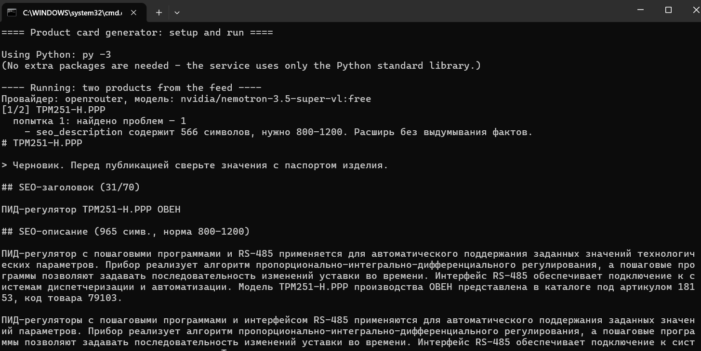
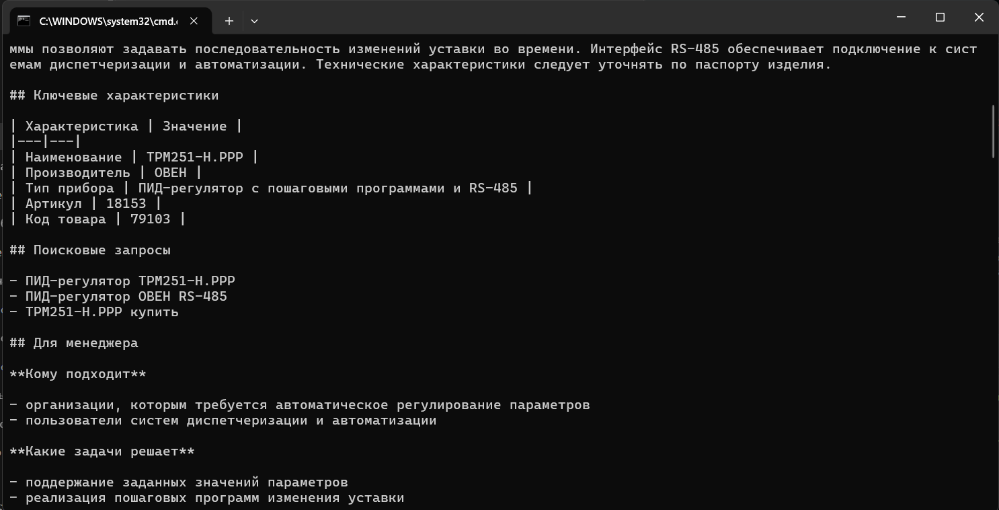
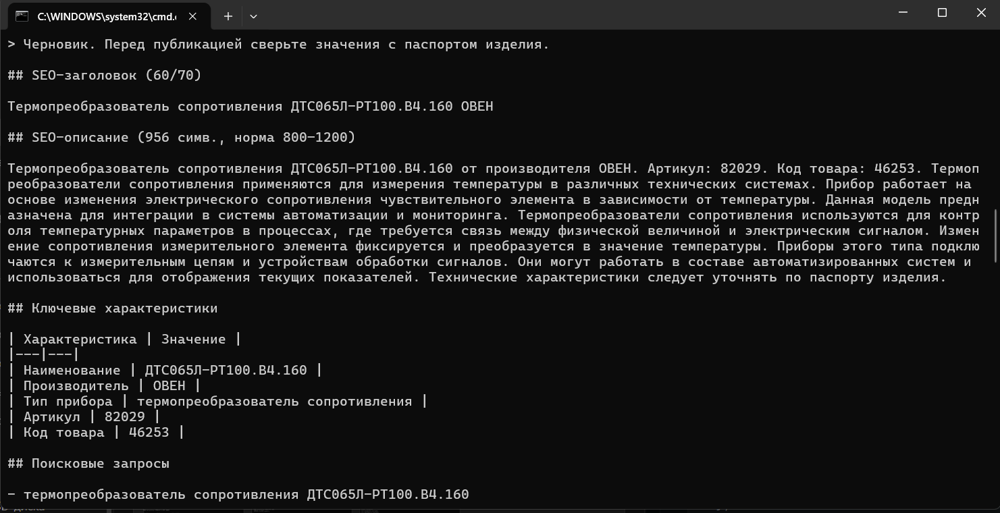
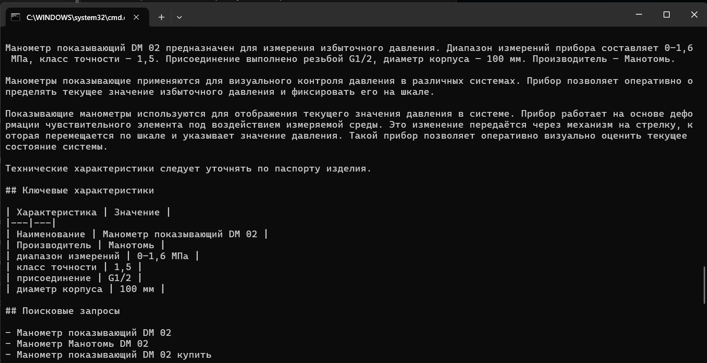

# Генератор черновиков карточек товаров (КИП, B2B)

Прототип сервиса: по данным о приборе в JSON формирует черновик карточки для B2B-магазина с помощью LLM.

Для каждого товара на выходе:

- SEO-заголовок до 70 символов;
- SEO-описание 800–1200 символов;
- таблица ключевых характеристик (**только из входных данных**, пропуски помечены «данных нет»);
- 3–5 поисковых запросов;
- commercial-блок для менеджера: кому подходит, какие задачи решает, что уточнить;
- список того, чего не хватает: незаполненные поля входа и характеристики, которые стоит запросить в паспорте.

Главная задача проекта — **не выдумывать технические характеристики**. Как это обеспечено, описано в [DECISIONS.md](DECISIONS.md).

## Как это выглядит

Запуск на Windows через `setup_and_run.bat` с бесплатной моделью OpenRouter (`nvidia/nemotron-3.5-super-vl:free`) на двух приборах из фида souz-pribor.ru и на примере из текста задания. Ни в одном результате нет чисел и параметров, которых нет во входных данных. Если модель выдаёт слишком короткое описание, видны повторные попытки (например, «попытка 1: … 566 символов»), после которых длина приходит в норму.

| ТРМ251-Н.РРР (ОВЕН), в фиде нет характеристик | ДТС065Л-РТ100.В4.160 (ОВЕН), в фиде нет характеристик | Манометр DM 02, пример с полными данными |
|---|---|---|
| [описание](docs/screenshots/screenshot_01.png), [таблица и запросы](docs/screenshots/screenshot_02.png), [блок менеджера](docs/screenshots/screenshot_03.png) | [описание](docs/screenshots/screenshot_04.png), [запросы и блок менеджера](docs/screenshots/screenshot_05.png), [чего не хватает](docs/screenshots/screenshot_06.png) | [описание](docs/screenshots/screenshot_07.png), [таблица и запросы](docs/screenshots/screenshot_08.png), [блок менеджера и итог](docs/screenshots/screenshot_09.png) |






Один готовый результат в файлах: [examples/output/](examples/output/) (Markdown и JSON для ТРМ251). Бесплатные модели отвечают нестабильно и упираются в суточные лимиты, поэтому запустить пример можно со своим ключом (см. ниже). Ключ в репозиторий не входит.

## Поддерживаемые LLM

Внешние пакеты для запуска не нужны, только Python 3.10+. Сервис сам выбирает провайдера по тому, какой ключ задан.

| Провайдер | Переменная в `.env` | Стоимость | Модель по умолчанию |
|---|---|---|---|
| Groq | `GROQ_API_KEY` | бесплатный уровень, карта не нужна ([ключ](https://console.groq.com/keys)) | `openai/gpt-oss-120b` |
| OpenRouter | `OPENROUTER_API_KEY` | бесплатные модели `:free` ([ключ](https://openrouter.ai/keys)) | `nvidia/nemotron-3.5-super-vl:free` (плюс резервные) |
| Gemini | `GEMINI_API_KEY` | бесплатный уровень, но в ряде стран (в т. ч. России) недоступен | `gemini-2.5-flash` |
| Локальный сервер (Ollama и др.) | `CARDGEN_BASE_URL`, `CARDGEN_MODEL` | бесплатно, ключ не нужен | задаётся вручную |
| Anthropic | `ANTHROPIC_API_KEY` | платный, нужен `pip install anthropic` | `claude-sonnet-5-5` |

Бесплатные тарифы и список бесплатных моделей меняются. Если модель по умолчанию недоступна, задайте другую через `CARDGEN_MODEL` или `--model`. У бесплатных тарифов небольшие лимиты запросов: при ошибке 429 сервис сам делает паузу и повторяет запрос. Для OpenRouter с моделью по умолчанию дополнительно передаётся список резервных бесплатных моделей: если основная перегружена, OpenRouter сам переключится на следующую. В JSON-результате в поле `model` указана модель, которая реально ответила. Если вы задали модель сами, резервные не используются.

## Установка и запуск

**Windows, самый простой путь:** дважды кликните `setup_and_run.bat`. Он при необходимости установит Python, спросит ключ, запустит оба примера и откроет папку с результатами.

**Вручную:**

```bash
git clone <url-репозитория>
cd product-card-generator

cp .env.example .env             # Windows: copy .env.example .env
# откройте .env и впишите ключ, например GROQ_API_KEY=...

python -m cardgen examples/products.json -o examples/output
```

Другие запуски:

```bash
# пример из текста задания (товар с характеристиками)
python -m cardgen examples/sample_from_task.json -o examples/output

# проверить вход и посмотреть, что уйдёт в модель, без обращения к API и без ключа
python -m cardgen examples/products.json --dry-run

# выбрать провайдера и модель явно
python -m cardgen examples/products.json --provider openrouter --model <имя-модели>

# данные из stdin
cat product.json | python -m cardgen -
```

Ключ читается из переменной окружения или из файла `.env`. Файл `.env` в `.gitignore`, в коде ключей нет.

Результат печатается в консоль и сохраняется в `-o` (по умолчанию `out/`): для каждого товара файлы `.md` (удобно копировать в CMS) и `.json` (для интеграций).

Параметры: `--provider`, `--model`, `--format md|json|both`, `--max-attempts`, `--quiet`, `--dry-run`.

### Формат входа

Один объект или список объектов. Обязательно только `name`.

```json
{
  "name": "Манометр показывающий DM 02",
  "manufacturer": "Манотомь",
  "product_type": "манометр",
  "specs": {"диапазон измерений": "0–1,6 МПа", "класс точности": "1,5"},
  "description": "Прибор предназначен для измерения избыточного давления.",
  "url": "https://example.com/product"
}
```

Допускаются русские названия полей (`название`, `производитель`, `характеристики`, `описание`). Пустые значения, `-`, `n/a`, «нет данных» считаются незаполненными и попадают в раздел «Каких данных не хватает».

### Коды возврата

`0` — всё успешно; `1` — часть товаров пропущена или не обработана (ошибка входа или API); `2` — невозможно начать (нет файла, битый JSON, нет ключа).

## Тесты

```bash
pip install pytest
python -m pytest
```

Тесты не обращаются к настоящим API. Бэкенд проверяется на локальном HTTP-сервере, который имитирует ответы, лимиты и ошибки провайдера. Проверяются разбор и валидация входа, проверки результата (длины, выдуманные числа), повторные попытки, выбор провайдера и запуск командной строки целиком.

## Структура

```
cardgen/
  product.py   разбор и валидация входа
  prompts.py   системный промпт и схема ответа модели
  backends.py  провайдеры LLM, ошибки, повторы при лимитах
  llm.py       генерация, проверка результата, повторные попытки, сборка карточки
  checks.py    автопроверки результата (длины, числа не из входа)
  render.py    вывод в Markdown
  cli.py       командная строка, чтение .env
examples/      входные данные и папка для результатов
tests/         тесты
DECISIONS.md   промпты, принятые решения, ограничения и план улучшений
```
